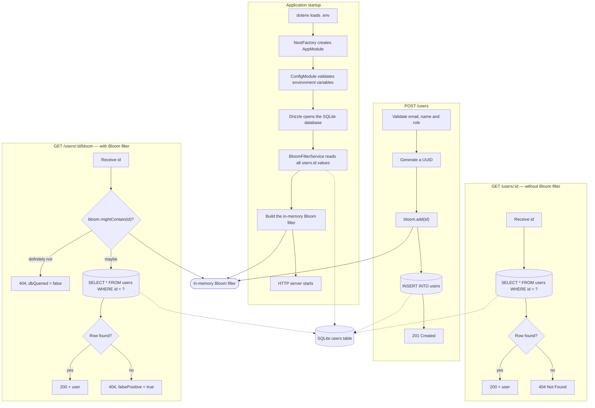

# Bloom Filters Demo

A small **NestJS + Drizzle ORM + SQLite** demo that adds a Bloom filter in front of user lookups.

It exposes the same lookup twice — once directly against SQLite and once guarded by a Bloom filter — so the difference is easy to see:

- `GET /users/:id` always queries the database.
- `GET /users/:id/bloom` checks the filter first and only queries the database when the filter says the ID may exist.

## System flow



Dashed edges indicate SQLite access. The Bloom filter lives in process memory; SQLite remains the source of truth.

## Requirements

- Node.js 24+ (the project uses the built-in `node:sqlite` driver)
- pnpm

## Setup

Install the existing dependencies:

```bash
pnpm install
```

Create `.env`:

```bash
cp .env.example .env
```

Create the `users` table manually with your preferred SQLite client. **This project intentionally does not include migrations.**

```sql
CREATE TABLE users (
  id TEXT PRIMARY KEY NOT NULL,
  email TEXT NOT NULL,
  name TEXT NOT NULL,
  role TEXT NOT NULL CHECK (role IN ('admin', 'user'))
);
```

For example, using the SQLite CLI:

```bash
sqlite3 bloom_filters.db <<'SQL'
CREATE TABLE users (
  id TEXT PRIMARY KEY NOT NULL,
  email TEXT NOT NULL,
  name TEXT NOT NULL,
  role TEXT NOT NULL CHECK (role IN ('admin', 'user'))
);
SQL
```

Start the application:

```bash
pnpm start:dev
```

## API

### Create a user

```bash
curl -X POST http://localhost:3000/users \
  -H 'content-type: application/json' \
  -d '{"email":"ada@example.com","name":"Ada Lovelace","role":"admin"}'
```

`role` is optional and defaults to `user`. The generated UUID is added to the Bloom filter before the row is inserted, so a failed insert can only produce a false positive, never a false negative.

### Direct database lookup

```bash
curl http://localhost:3000/users/<uuid>
```

```json
{
  "found": true,
  "user": {
    "id": "7f9c...",
    "email": "ada@example.com",
    "name": "Ada Lovelace",
    "role": "admin"
  },
  "lookup": {
    "strategy": "database",
    "bloomChecked": false,
    "dbQueried": true,
    "durationUs": 31.4
  }
}
```

### Bloom-filtered lookup

```bash
curl http://localhost:3000/users/<uuid>/bloom
```

When the filter can rule the ID out:

```json
{
  "found": false,
  "user": null,
  "lookup": {
    "strategy": "bloom",
    "bloomChecked": true,
    "maybePresent": false,
    "dbQueried": false,
    "durationUs": 11.8
  }
}
```

The response is `404`, but the SQLite query was skipped. When the filter has a false positive, the database is queried and `lookup.falsePositive` is `true`.

### A note about SQLite

SQLite is embedded and indexed primary-key lookups are already extremely fast. In local benchmarks, a Bloom check can cost a similar amount of time to the SQLite lookup itself, so the guarded path is not automatically faster for hits. The Bloom filter's advantage shows up when:

- the database is remote and every avoided query saves network I/O and server work;
- the dataset is large enough that index lookups are expensive;
- most lookups miss (for example, bot traffic or enumeration attempts);
- the key set is much larger than the available memory for a full cache/set.

## Configuration

| Variable                           |            Default | Description                               |
| ---------------------------------- | -----------------: | ----------------------------------------- |
| `DATABASE_URL`                     | `bloom_filters.db` | SQLite file path                          |
| `PORT`                             |             `3000` | HTTP port                                 |
| `BLOOM_FILTER_FALSE_POSITIVE_RATE` |             `0.01` | Target false-positive rate                |
| `BLOOM_FILTER_CAPACITY_MARGIN`     |              `1.3` | Extra capacity to reduce early saturation |

## How the filter is maintained

- On startup, the service loads all user IDs and builds the filter in-process.
- The filter is sized from the current user count, the capacity margin, and the target false-positive rate.
- `POST /users` adds new IDs at runtime.
- The filter is per-process. If you insert rows directly into SQLite while the app is running, restart the app (or add a rebuild endpoint) to include them.
- Standard Bloom filters cannot delete individual entries. Deleted IDs may still be reported as “maybe present”, which only causes an unnecessary database query.
- Bloom filters are probabilistic: they can produce false positives, but never false negatives when correctly synchronized.
